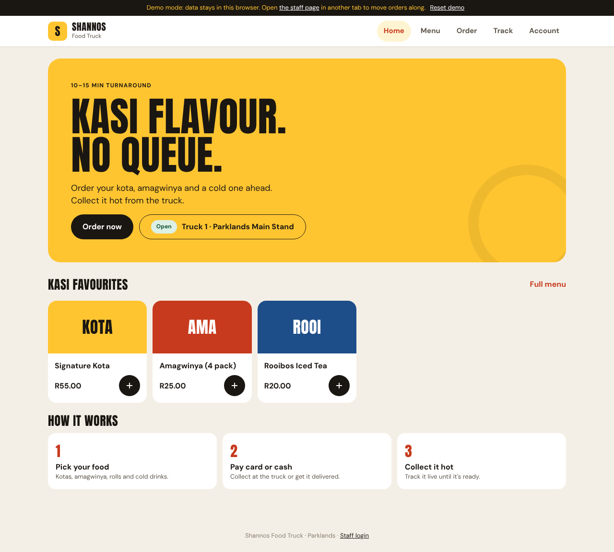
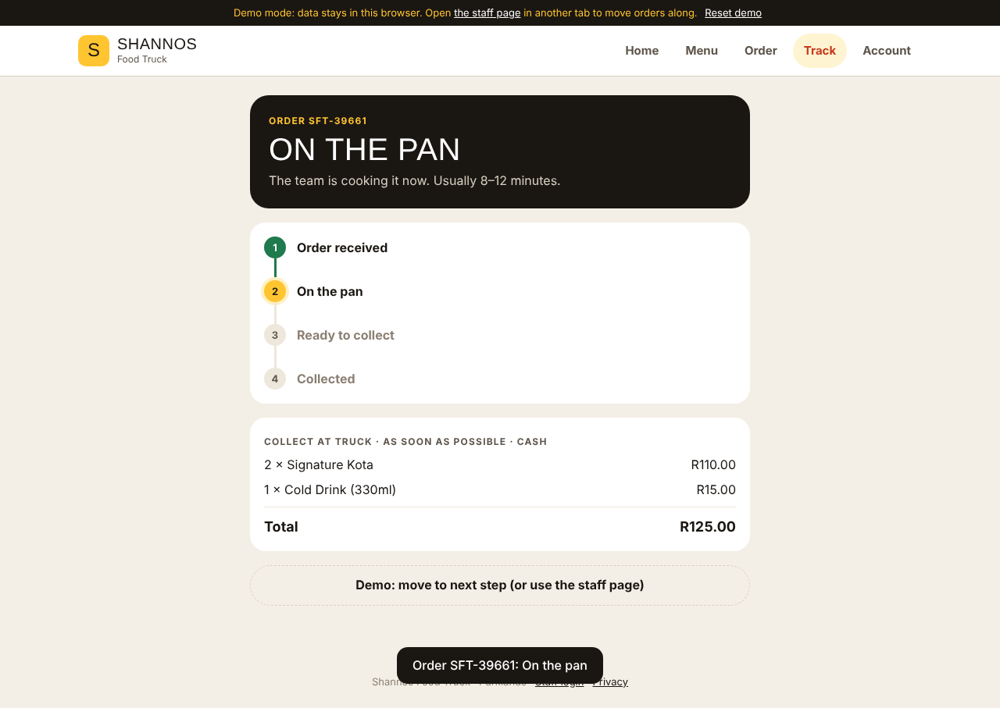
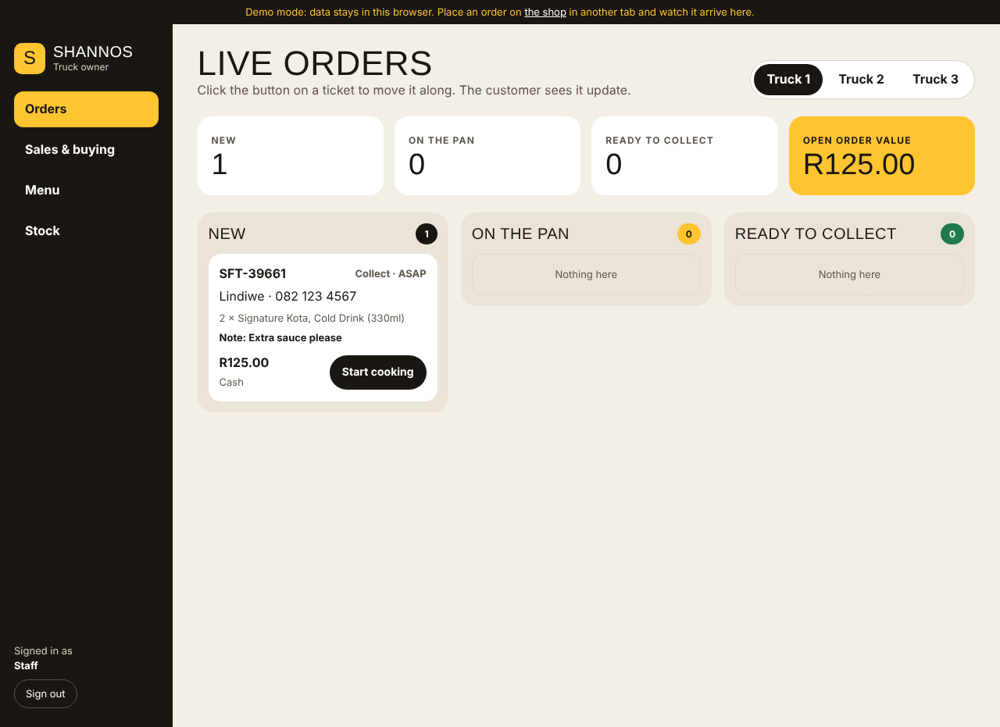
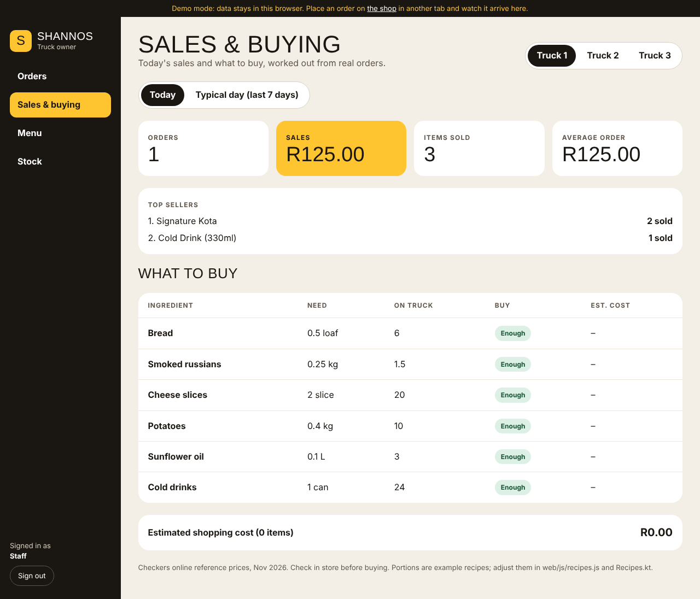
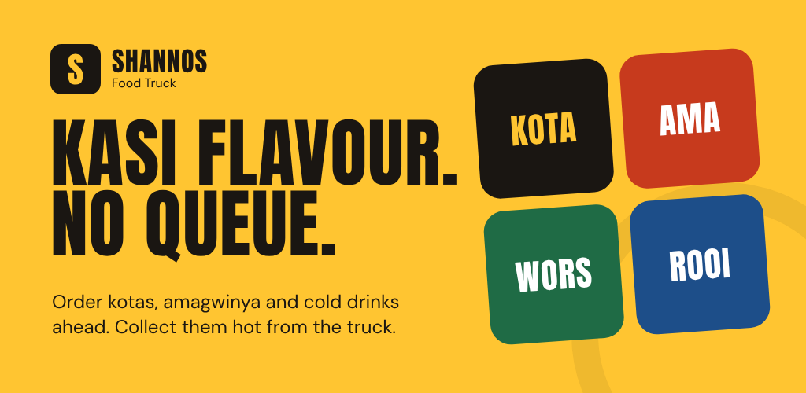

# Shannos Food Truck

Order-ahead app for Shannos Food Truck: kasi food (kotas, amagwinya, rolls, cold drinks), ordered from your phone and collected hot from the truck.

Built by the **Zentra** team.

| Role | Name |
| --- | --- |
| Team Lead, DevOps & repo | Kamv'elihle Dyantyi |
| UI/UX & Design | Katleho Khutsoane |
| Requirements Analysis | Neziswa Bikitsha |
| Database & Development | Amandla Sekeleni |

- **Design prototype:** see the Shannos Food Truck prototype canvas (customer app + owner dashboard).
- **Demo video (v1):** https://youtu.be/KhhJptnaOf4

## Website

A website for customers and staff, in `web/`, sharing the **same Firebase project** as the app:

- **Customer site** (`index.html`): menu, cart, checkout, live order tracking, feedback, and **Continue with Google** with *My orders*.
- **Staff dashboard** (`staff.html`): Google or email login, live order board per truck, **Sales & buying** (sales report + Daily Purchase Recommendation), sold-out toggles, stock.
- An order placed on the website shows up instantly on the app's staff dashboard, and the reverse. The same Google account works on both *(innovative feature)*.

| Customer: home | Customer: live tracking | Staff: live orders | Staff: sales & buying |
| --- | --- | --- | --- |
|  |  |  |  |

More screenshots: [`docs/screenshots/web`](docs/screenshots/web).

### Try the website locally
The site uses JavaScript modules, so it must be served over http (double-clicking `index.html` won't work):
```
cd web
python -m http.server 8000
```
Then open http://localhost:8000. In VS Code, the *Live Server* extension also works.

`web/js/config.js` has `USE_FIREBASE = false` by default, which is **demo mode**: data stays in your browser. Open the shop in one tab and `staff.html` in another (any email and a 6+ character password) to watch orders move live.

### Put the website online (Firebase Hosting, free)
1. Firebase console → ⚙ Project settings → Your apps → **Add app → Web**. Copy the `appId` into `web/js/config.js` and set `USE_FIREBASE = true`.
2. Install the Firebase CLI once: `npm install -g firebase-tools`, then `firebase login`.
3. From the repo root: `firebase deploy --only hosting`. The site goes live at **https://shannos-food-truck.web.app**.
4. Google sign-in works on that address automatically (Firebase authorises its own domains). For any other domain, add it under Authentication → Settings → Authorized domains.

Website logging: open DevTools (F12) → Console and filter by `Shannos`.

## What the app does

**Customers** (no account needed):
1. Pick a truck (Truck 1: corner of Sandown Road and Discovery Drive, Rivergate; Trucks 2 and 3 coming soon) → browse the menu by category (Kotas, Sides, Rolls, Drinks)
2. Add items, leave a note for the kitchen, check out: collect or delivery (**free in Parklands, R50 outside**), **ASAP or a pickup time**, card or cash
3. Track the order live: Received → On the pan → Ready to collect → Collected
4. Rate the food

**Account** (single sign-on):
- *Continue with Google* on the Account tab. Optional: guests can still order.
- Signing in keeps your name for checkout and shows **My orders** (live), on any phone. A guest who signs in keeps the order they just placed.
- Stays signed in between launches until you tap *Sign out*. *Delete my account* removes the login for good.
- **Settings:** my truck, remember my details, privacy policy, staff login.

**Staff** (Account → *Staff login*, with Google or email):
- Live order board per truck. One tap moves an order to the next stage, and the customer's phone updates instantly.
- **Sales & buying:** today's (or a typical day's) orders, sales, average order and top sellers, plus a **Daily Purchase Recommendation**: ingredients needed from real orders, minus what's on the truck, rounded up to the packs Checkers sells, with an estimated cost *(innovative feature)*
- Mark menu items sold out (they disappear from customers' carts straight away)
- Stock levels with Low / Out flags

## Tech

- Kotlin, Jetpack Compose (Material 3), Navigation Compose, ViewModel + StateFlow
- Firebase: Cloud Firestore (real-time data) and Authentication (Google SSO, guest, staff email)
- Android Credential Manager for Google sign-in
- Logging through one `AppLog` helper (filter Logcat with `tag:Shannos`)
- Gradle 8.11 · Android Gradle Plugin 8.10 · Kotlin 2.0 · JDK 17 · min SDK 24 · target SDK 36 (Android 16, required by Google Play since 31 Aug 2026)

```
app/src/main/java/com/example/shannosfoodtruck/
├── MainActivity.kt / ShannosApp.kt     app entry + shared objects
├── data/                               models, cart maths, repositories
│   ├── Recipes.kt                      ingredients, Checkers prices, recipes, PurchasePlanner
│   ├── PickupTimes.kt                  pickup time slots (06:00 to 20:00)
│   ├── FoodRepository.kt               the one interface all screens use
│   ├── FirestoreRepository.kt          live Firebase implementation
│   └── DemoRepository.kt               offline/in-memory implementation (tests + demos)
└── ui/
    ├── theme/                          kasi colours + type
    ├── components/                     shared buttons, tiles, fields
    ├── auth/                           Google sign-in (Credential Manager)
    ├── customer/                       home, menu, cart, checkout, track, feedback, account
    └── staff/                          login + dashboard
```

## Run it

1. Open the project in Android Studio and let Gradle sync.
2. Run on a phone (USB debugging) or an emulator.

**No internet or Firebase not set up yet?** In `app/build.gradle.kts` set `USE_FIREBASE` to `"false"`. The app then runs on built-in demo data, and any email + 6-character password works for staff login.

## Firebase setup (once)

In the [Firebase console](https://console.firebase.google.com) for this project:

1. **Authentication → Sign-in method:** enable **Google**, **Anonymous** and **Email/Password**.
1. **Add every developer's SHA-1 fingerprint** (Google sign-in fails with "developer error" without it):
   - In Android Studio's terminal run `./gradlew signingReport` and copy the **SHA1** line under `Variant: debug`.
   - Firebase console → ⚙ Project settings → Your apps → the Android app → **Add fingerprint** → paste → Save.
   - Each team member's computer has its own debug key, so each person adds theirs. Add the release key's SHA-1 too when we sign for the Play Store.
   - Download the updated `google-services.json` and replace `app/google-services.json`.
2. **Authentication → Users:** add a staff user (e.g. the owner's email). Copy their **User UID**.
3. **Firestore → Data:** create a collection `staff` with a document whose ID is that UID (to let a staff member use Google instead, sign in with Google once, then copy *that* UID from Authentication → Users) (fields can be anything, e.g. `name: "Owner"`).
4. **Firestore → Rules:** paste the contents of [`firestore.rules`](firestore.rules) and publish.
5. In the app: Account → Staff login → sign in → **Menu → Load starter menu**. This creates the menu, the three trucks and stock lists. It never overwrites existing data.

Old collections from v1 (`menu_items`, sample `orders`/`feedback`) are no longer used and can be deleted.

## Google Play

Release guide, store listing text, data-safety answers and graphics: **[docs/play-store](docs/play-store/README.md)**.
Release builds are signed from `keystore.properties` (local) or GitHub secrets (CI), and neither is ever committed.



## Logging

All logs go through `data/AppLog.kt` with the tag **`Shannos`**. In Android Studio open **Logcat** and type `tag:Shannos` to see the app's story as you use it, for example:

```
I Shannos: [App] Started v2.4 using Firebase (live data)
D Shannos: [CustomerVM] Menu loaded: 11 items, 1 sold out
I Shannos: [Auth] Signed in with Google
D Shannos: [FirestoreRepository] Placing order SFT-48213 (3 items) for truck1
D Shannos: [CustomerVM] Order SFT-48213 is now COOKING
```

Levels: `d` normal flow, `i` sign-in/out, `w` recovered problems, `e` failures shown to the user. Passwords, tokens and phone numbers are never logged.

## How to use it (end-user guide)

**Ordering (customers)**
1. Open the app (or the website). On **Home**, check the truck shown at the top; tap it to change truck.
2. Tap **Order now**. Use the tabs (Kotas, Sides, Rolls, Drinks) and tap **+** to add food. Use **− / +** to change how many.
3. Tap **Order** in the bottom bar. Add a note for the kitchen if you like, then **Checkout**.
4. Choose **Collect at truck** or **Deliver to me** (pick *In Parklands* for free delivery, or *Outside Parklands* for R50 and type your address).
5. Choose **ASAP** or a time, enter your name and cellphone number, choose **Card** or **Cash**, and tap **Place order**.
6. The **Track** screen shows your order number and updates by itself: *Order received → On the pan → Ready to collect → Collected*. Show the order number at the window.
7. After collecting, tap **Rate your food**.

**Your account (optional)**
- **Account → Continue with Google** saves your details and shows **My orders** on any phone and on the website.
- **Settings:** change your truck, switch *Remember my details* on or off, read the privacy policy.
- **Sign out** or **Delete my account** at any time.

**Running the truck (staff)**
1. **Account → Staff login**, then sign in with Google or your staff email.
2. **Orders:** new orders appear by themselves. Tap **Start cooking**, then **Mark ready**, then **Collected**. The customer's phone updates instantly. Tickets show the pickup time in red if it isn't ASAP.
3. **Sales & buying:** see today's sales and top sellers, and **What to buy**: the ingredients to buy (in Checkers packs) with an estimated cost. Switch to *Typical day (last 7 days)* to plan tomorrow's shop.
4. **Menu:** tap an item to mark it **Sold out** (or available again).
5. **Stock:** what's on the truck, with **Low / Out** warnings.
6. Use the truck buttons at the top to switch between trucks.

## Tests and evidence

**App unit tests** (33 tests, run on every push):
```
./gradlew testDebugUnitTest
```
- `CartTest`: cart maths, sold-out handling, quantity cap, phone validation, order stages, stock status
- `PurchasePlannerTest`: every menu item has a recipe, sales summary, ingredient usage, rounding up to whole packs, subtracting stock, 7-day average, delivery fees, pickup time slots
- `OrderFlowTest`: full customer → staff → customer journey on demo data, invalid checkout blocked, Google sign-in keeps guest orders, sign-out, account deletion, staff Google login, coming-soon trucks, R50 delivery, remembered details, staff sales report

**Website end-to-end test** (`tests/web/e2e.mjs`, 20 checks): opens the shop and the staff dashboard in two browser tabs, places an order, moves it through every stage, and checks the customer sees each step live; also delivery fees, Sales & buying, sold-out, Google sign-in, settings, account deletion and the phone layout. GitHub Actions saves its screenshots as the **website-test-screenshots** artifact.

**Physical phone testing:** see the checklist in [`docs/testing.md`](docs/testing.md).

GitHub Actions also builds the APK on every push. Download it from the workflow run's artifacts.

## Team workflow

- No direct commits to `main`. Work on `feature/<name>` branches and open a Pull Request.
- The Team Lead reviews PRs against the design prototype.
- CI must be green before merging.

## Release notes

### v2.4 — Lecturer feedback and client requirements
- **New: Daily Purchase Recommendation** (Task 1, FR-10/FR-14) for staff on app and web: turns real orders into a shopping list of Checkers packs, minus stock on the truck, with an estimated cost *(innovative feature)*.
- **New: sales report** (Task 1, FR-12): orders, sales, average order and top sellers for today or the last 7 days.
- **New: preferred pickup time** (Task 1, FR-04): ASAP or a 15-minute slot between 06:00 and 20:00, shown on staff tickets.
- **New: delivery pricing:** free in Parklands, R50 outside, added to the total.
- **New: real truck location:** Truck 1 at the corner of Sandown Road and Discovery Drive, Rivergate; Trucks 2 and 3 shown as *Coming soon* (no more placeholders).
- **New: Settings** (Task 2 feedback): my truck, remember my details, privacy policy, staff login.
- **New: website end-to-end test in CI** (Task 1 feedback: automated testing evidence), with screenshots saved on every run.
- Stock is now tracked per ingredient with units (loaves, kg, slices…).
- Confirmation only after the order is saved (Task 2 feedback) is now commented in the code on both platforms.
- End-user guide and physical-phone test checklist added.
- Targets Android 16 (API 36), which Google Play has required for new apps since 31 August 2026 (Android Gradle Plugin 8.10).

### v2.3 — Ready for Google Play
- **New app icon:** the Shannos "S" on sign yellow (adaptive icon plus legacy sizes).
- **New: Delete my account** in the app and on the website (Google Play requires this for apps with sign-in).
- **New: privacy policy page** (`web/privacy.html`) covering POPIA rights and account deletion.
- **Release signing** from a local `keystore.properties` or GitHub secrets; CI builds a **signed APK and App Bundle** when the secrets are set.
- Play Store listing text, data-safety answers, 512 px icon and feature graphic in `docs/play-store`.

### v2.2 — Website
- **New: customer website** with the full ordering flow, live tracking, feedback and **Google sign-in**, sharing data with the app *(innovative feature)*.
- **New: staff web dashboard** with Google or email login, live order board per truck, sold-out toggles and stock.
- **New: cross-platform live sync.** Order on the website and staff see it in the app, or the reverse.
- Website demo mode (no Firebase needed), with live updates between browser tabs.
- Same kasi design as the app; responsive from phone to desktop; accessible labels and keyboard support.
- Firebase Hosting config (`firebase.json`); CI now also checks the website scripts.

### v2.1 — Google single sign-on and logging
- **New: Continue with Google** (SSO) for customers on a new **Account** tab, using Android Credential Manager and Firebase Authentication.
- **New: guest-to-Google account linking.** Order as a guest, sign in afterwards, and the order stays with you.
- **New: My orders.** A signed-in customer's order history, updating live.
- **New: staff can sign in with Google** as well as email; only accounts on the staff list get in.
- Session stays signed in between launches; *Sign out* ends it and stops tracking that account's order.
- Checkout name is pre-filled from the Google account.
- Logging added throughout (`AppLog`, tag `Shannos`).
- Staff login moved from Home to the Account tab.
- Firestore rules: customers may list only their own orders.

### v2.0 — Full rebuild (since the prototype)
- Rebuilt the whole app in **Jetpack Compose** to match the new kasi-style design prototype; removed the old Fragment/XML screens.
- **One login system and one data source** (Firebase) instead of two logins (Firebase + local SQLite) and two settings screens.
- Fixed: Settings screen crash on open; failing tests; CI broken by a non-executable `gradlew` and mismatched Gradle/Kotlin/Java versions.
- **New: live order tracking.** Received → On the pan → Ready → Collected, updated instantly when staff move the order *(innovative feature)*.
- **New: staff dashboard in the app.** Live order board per truck, one-tap stage changes, sold-out toggles, stock levels *(innovative feature)*.
- **New: multi-truck ordering.** Customers choose which truck to collect from.
- **New: sold-out items disappear from carts automatically** when staff mark them out.
- **New: guest checkout** with South African cellphone validation, collect-or-delivery and card-or-cash.
- **New: feedback is saved** (it was previously discarded).
- **New: Firestore security rules**; no more fake orders/feedback written to the live database.
- **New: offline demo mode** (`USE_FIREBASE = false`) and unit tests; CI uploads the APK.

## Still to do

- Deploy the website (Firebase Hosting steps above)
- Change the application ID and upload to Play internal testing ([guide](docs/play-store/README.md))
- Owner details in `web/privacy.html`: date, how long orders are kept, contact email
- Truck 2 and Truck 3 locations, once decided (`StarterData.kt` and `web/js/starter-data.js`)
- Check the example recipes in `Recipes.kt` / `web/js/recipes.js` against Shannon's real portions
- Online card payments (a payment gateway); today card or cash is paid at collection or delivery
- Stock that drops automatically as orders are placed
- Push notifications when an order is ready (Task 1, FR-15)
- Anton headline font in the app (instructions in `ui/theme/Theme.kt`)

Project documents (plan, report, architecture, task list, old HTML prototype) are in [`docs/`](docs/).
